# Quality of Experience

## Jak mierzyć jakość doświadczaną przez widza?

Mikołaj Leszczuk

Materiały źródłowe: Mikołaj Leszczuk, Zdzisław Papir, Lucjan Janowski, Jakub Nawała.

---

## Plan wykładu

1. Od parametrów sieci do doświadczenia widza
2. Eksperymenty subiektywne i interpretacja ocen
3. Wskaźniki automatyczne i modele jakości
4. Zastosowania: od laboratorium po monitoring usług

---

## Dlaczego dostawca mierzy jakość?

**OTT (Over-the-Top)** to dostarczanie usługi wideo przez internet niezależnie od operatora dostępu. Serwis OTT może oferować transmisje na żywo i materiały na żądanie.

Dostawca usługi nie kontroluje całej drogi do odbiorcy. Widz może jednak zrezygnować z usługi, gdy odtwarzanie regularnie zawodzi.

Konkurencja między dostawcami i zmieniające się sposoby korzystania z mediów sprawiają, że sam pomiar parametrów sieci nie wystarcza.

---

## Zanim wideo na żądanie stało się codziennością

W 1994 r. Thomas Miki wiązał przetrwanie dostawców z wydajnością, niezawodnością i elastycznością. W 1995 r. Daniel Minoli opisywał rywalizację operatorów, sieci kablowych i dostawców internetu, wskazując wideo jako motor rozbudowy infrastruktury.

---

## Jak prognozowano wzrost ruchu wideo?

Cisco w 2018 r. prognozowało na lata 2017-2022:

- ok. trzykrotny wzrost całego ruchu IP,
- udział wideo w ruchu IP na poziomie 82% w 2022 r.,
- siedmiokrotny wzrost ruchu z monitoringu wideo.

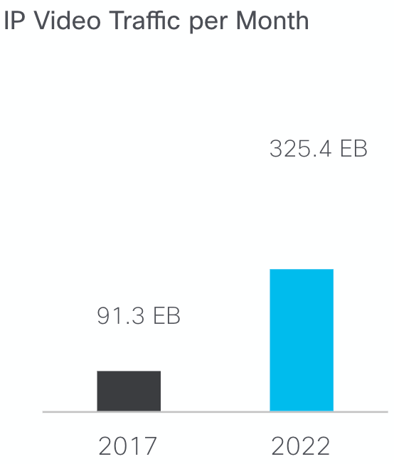

To prognozy z raportu Cisco Visual Networking Index, nie pomiary z 2022 r.

---

## Prognoza ruchu na użytkownika

Cisco prognozowało wzrost z **28,8 GB** w 2017 r. do **84,6 GB miesięcznie** w 2022 r., czyli o ok. 194%.

Wykres dotyczy całkowitego ruchu na użytkownika stacjonarnego internetu konsumenckiego, nie samego wysyłania.

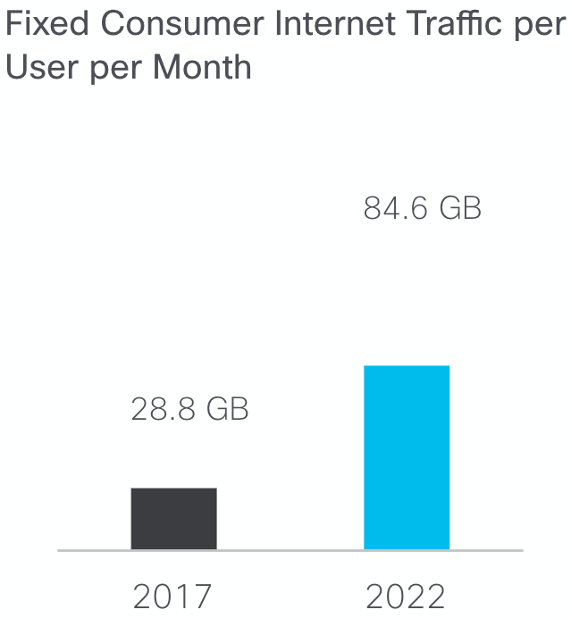

---

## Co umożliwia dostarczanie wideo?

- **Dostęp do sieci:** łącza przewodowe i bezprzewodowe w domu, w pracy i w podróży.
- **Kodowanie i adaptacja:** warianty materiału o różnych przepływnościach.
- **CDN (Content Delivery Network):** rozproszona sieć dostarczania treści.

Przepływność wysyłania jest ważna także dla transmisji tworzonych przez samych użytkowników.

---

## Technologie i miejsca odbioru

| Obszar | Przykłady ze źródłowego wykładu |
| :--- | :--- |
| Sieć szkieletowa i dostęp | Zwielokrotnianie długości fal (WDM), gigabitowy Ethernet, sieci światłowodowe, kablowe i telefoniczne |
| Dostęp lokalny | Wi-Fi, łączność przez przewody energetyczne (PLC), łączność ultraszerokopasmowa (UWB) |
| Odbiorniki | Telewizory o różnej rozdzielczości, komputery i urządzenia mobilne |

---

## Co zmienia przepływność wysyłania?

- Relacje i materiały tworzone przez odbiorców, w tym dziennikarstwo obywatelskie.
- Współtworzenie encyklopedii i udostępnianie zdjęć.
- Personalizacja treści oraz wstawianie reklam po stronie dostawcy to odrębne możliwości cyfrowego dostarczania mediów.

---

## QoS a QoE

**QoS (Quality of Service)**

Techniczna jakość usługi. Przykładowe miary sieciowe: przepływność, opóźnienie i utrata pakietów.

**QoE (Quality of Experience)**

Jakość doświadczana przez użytkownika: na ile usługa spełnia jego oczekiwania w danej sytuacji.

Ten sam parametr może mieć inne znaczenie w wideorozmowie i w filmie odtwarzanym z bufora.

---

## Głos, wideo i dane: inne wymagania

| Usługa | Co ma znaczenie? |
| :--- | :--- |
| Rozmowa | Niskie opóźnienie i małe wahania czasu dostarczania |
| Strumień wideo | Przepływność pozwalająca uzupełniać bufor oraz mało przerw |
| Pobieranie pliku | Czas zakończenia i poprawność danych |

Przepływność, opóźnienie i straty warto analizować w odniesieniu do konkretnej usługi.

---

## Dwie definicje jakości doświadczanej

**QUALINET**

Stopień zadowolenia lub irytacji zależy od tego, jak usługa spełnia oczekiwania wobec użyteczności i satysfakcji, przy aktualnych preferencjach odbiorcy.

**Möller i Raake**

Ocena dotyczy też potrzeb odbiorcy, przydatności lub przyjemności oraz kontekstu, cech osoby i jej aktualnego stanu.

<a href="https://doi.org/10.1007/978-3-319-02681-7">Quality of Experience: Advanced Concepts, Applications and Methods</a>.

---

## Źródła definicji

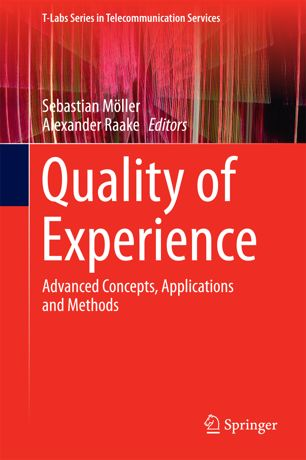

W badaniach jakości wideo działa też Video Quality Experts Group (VQEG).

---

## Od jakości sieci do jakości odbieranej

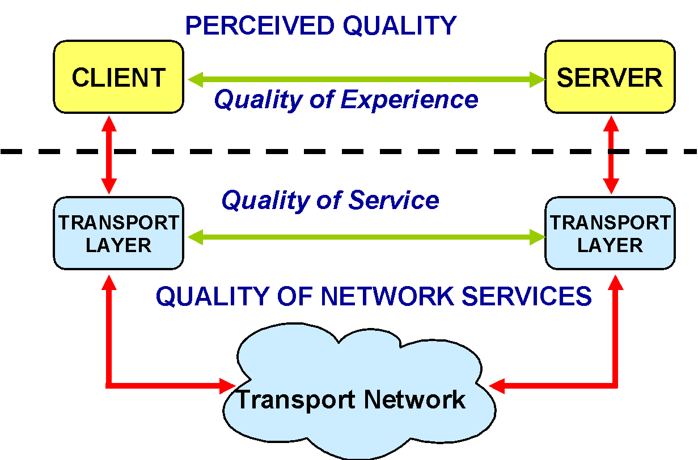

---

## Co wchodzi do oceny usługi?

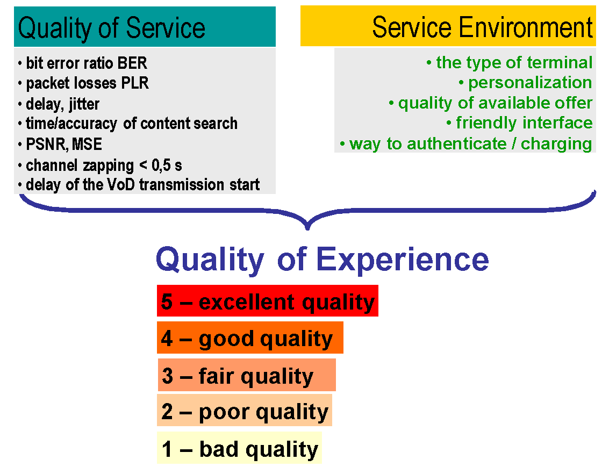

Ilustracja pokazuje możliwą skalę ocen; sposób pomiaru zależy od zadania i projektu badania.

---

## Co poza siecią wpływa na QoE?

| Czynnik | Przykład |
| :--- | :--- |
| Treść | Ruch w kadrze, drobny tekst |
| Dostarczanie | Czas startu, zmiany jakości, przerwy |
| Użyteczność i interakcja | Napisy, wyszukiwanie, sterowanie odtwarzaczem |
| Model biznesowy | Reklamy i oczekiwania wobec płatnej usługi |

Liczą się też ekran, warunki oglądania i zadanie widza.

---

## Jakość na końcu łańcucha

W środowisku OTT dostawcy rywalizują o odbiorcę. Żeby ustalić, czy problem może skłonić go do odejścia, trzeba wiedzieć, co faktycznie dotarło do jego urządzenia i jak zostało odtworzone.

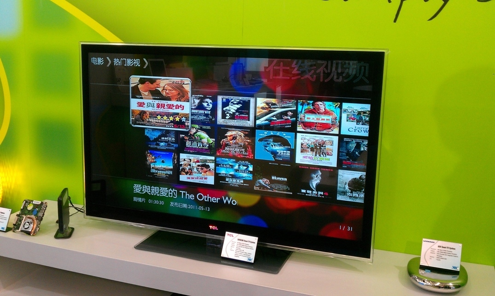

VIA Gallery, <a href="https://commons.wikimedia.org/w/index.php?curid=38934022">Wikimedia Commons</a>, CC BY 2.0.

---

## Wideo: ostrość czy ciągłość?

Ten sam film i ten sam spadek przepływności. Bufor pozwala przez chwilę odtwarzać film dalej.

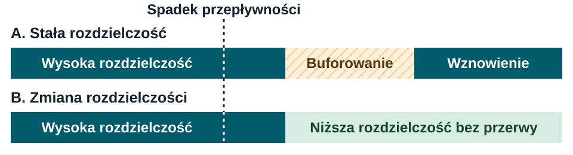

Jeśli segment o niższej przepływności dotrze na czas, nie będzie przerwy. Co ważniejsze: płynność sceny czy czytelność tekstu?

---

## Skąd wiadomo, co przeszkadza?

Przygotowujemy **eksperyment subiektywny**: uczestnicy oglądają próbki w ustalonych warunkach i oceniają ich jakość.

Kontrolujemy treść, rodzaj zakłóceń i warunki oglądania. Oceny stanowią punkt odniesienia do porównań i kalibracji modeli.

W działającej usłudze trudno zebrać oceny bez przerywania korzystania. Kontrolowany test pozwala oddzielić wpływ zakłócenia od sytuacji, w której widz używa usługi.

---

## Skąd dane do kalibracji?

Potrzebne są oceny wielu treści, poziomów jakości i osób. Rozbudowane badania mogą zbierać setki lub tysiące ocen. Nie jest to uniwersalny próg.

Warunki oglądania należy utrzymać porównywalne lub celowo uwzględnić ich zmianę w projekcie.

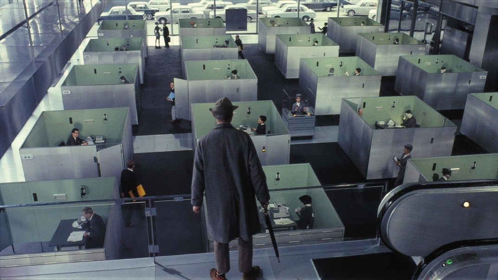

---

## Eksperyment jako pętla

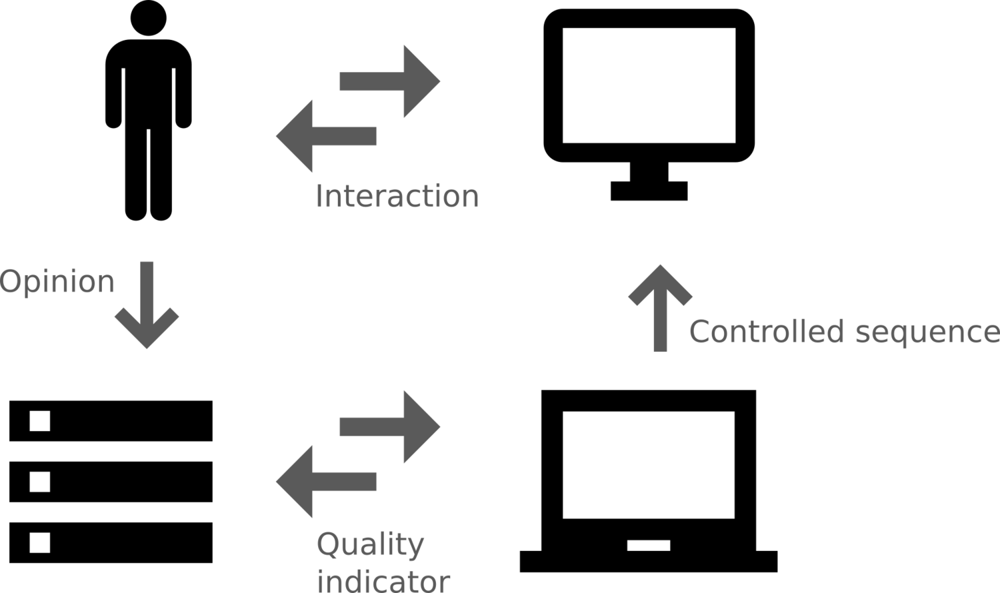

Opinia widza jest wynikiem eksperymentu. Wskaźnik automatyczny można z nią porównać.

---

## Co kontrolujemy w teście?

  
<strong>Opinia</strong> Ocena widza

  
<strong>Zniekształcenie</strong> Kontrolowany sygnał

  
<strong>Zadanie</strong> Ustalony sposób użycia

---

## Od materiału źródłowego do ocen

<strong>1. Źródło</strong> Scena bez badanej degradacji

<strong>2. Warunek</strong> Kodowanie, straty lub przerwy

<strong>3. Próbka</strong> Wideo po przetworzeniu

<strong>4. Oceny</strong> Odpowiedzi uczestników

W dokumentacji spotkasz skróty **SRC** (materiał źródłowy), **HRC** (warunek przetwarzania) i **PVS** (przetworzona sekwencja wideo).

---

## Warunki odsłuchu i oglądania

- Ustalić parametry ekranu, odległość, oświetlenie i głośność.
- Przygotować różne treści i reprezentatywne poziomy jakości.
- Ujednolić instrukcję i trening; zaplanować kolejność próbek.

Wynik odpowiada zadaniu i warunkom testu. Ocena czytelności tablicy rejestracyjnej to inne zadanie niż ocena komfortu oglądania filmu.

---

## Stanowisko do testów wideo

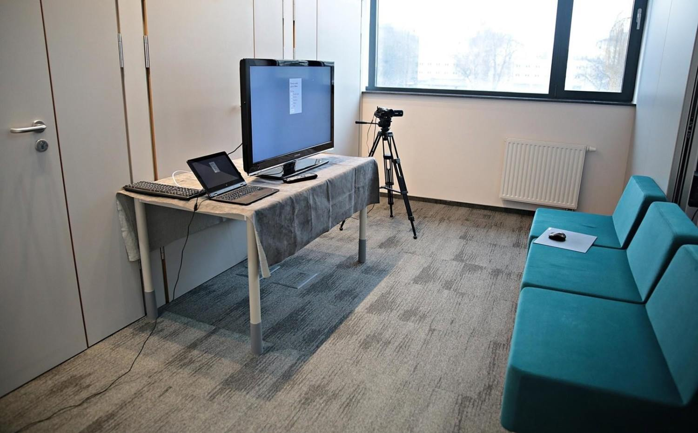

Archiwalne stanowisko AGH. Stałe ustawienie ekranu i miejsca uczestnika ułatwia porównywanie ocen.

---

## Laboratorium QoE AGH: infrastruktura

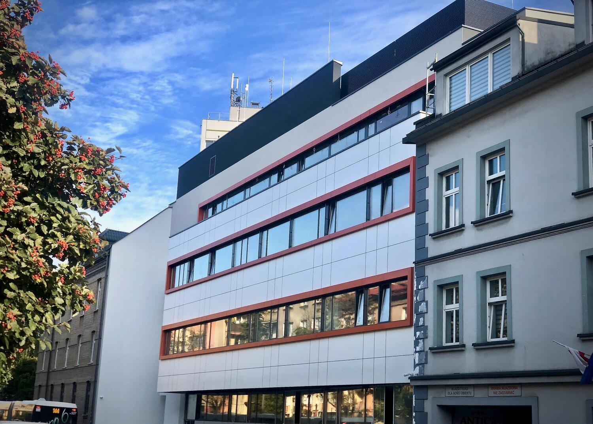

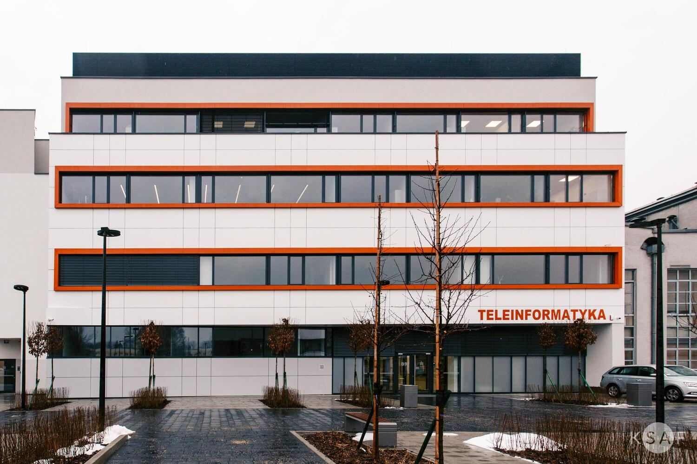

---

## Laboratorium QoE AGH: wnętrze i plan

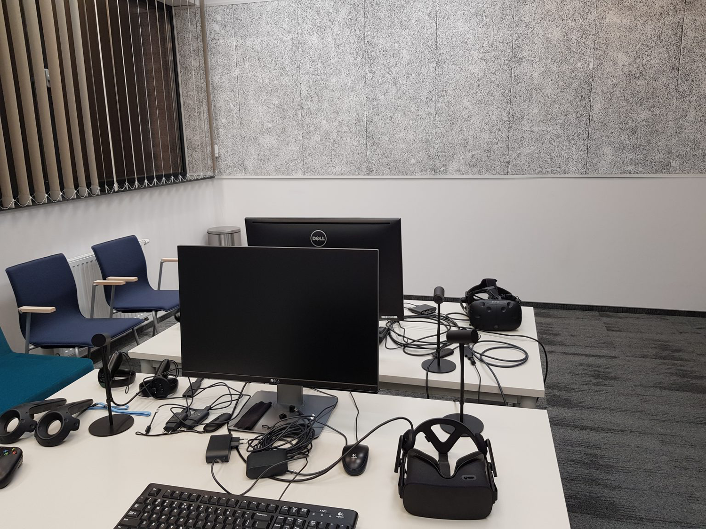

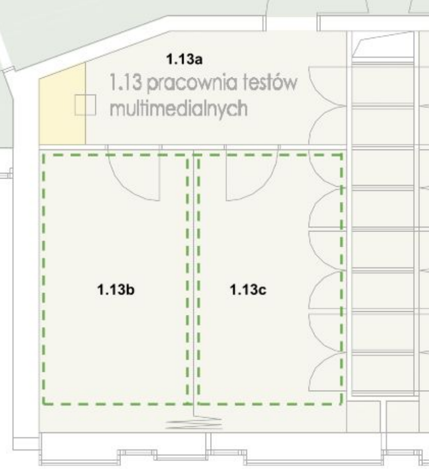

---

## ACR: ocena pojedynczej próbki

**ACR (Absolute Category Rating):** każdą próbkę ocenia się oddzielnie na skali kategorii.

| Wartość | 1 | 2 | 3 | 4 | 5 |
| :--- | :--- | :--- | :--- | :--- | :--- |
| Jakość | Zła | Słaba | Dostateczna | Dobra | Doskonała |

Sesja treningowa oswaja uczestników z zadaniem. Właściwe oceny zbiera się osobno.

---

## ACR: kolejność w sesji

Uczestnik ocenia każdą próbkę po zakończeniu odtwarzania, przed pokazaniem następnej.

---

## MOS: średnia z ocen

**MOS (Mean Opinion Score)** to średnia ocen zebranych dla danej próbki lub warunku.

Przykład: **3, 4, 4, 5, 4** daje **MOS = 4,0**.

Ta sama średnia może wynikać z bardzo różnych rozkładów. Warto pokazać też liczebność próby, rozrzut lub przedział ufności.

---

## Średnia, mediana i dominanta

Średnie można liczyć dla próbki, warunku przetwarzania lub uczestnika, ale każda z nich odpowiada na inne pytanie.

Mediana to wartość środkowa, dominanta to wartość najczęstsza. W rozkładach skośnych mogą różnić się od średniej.

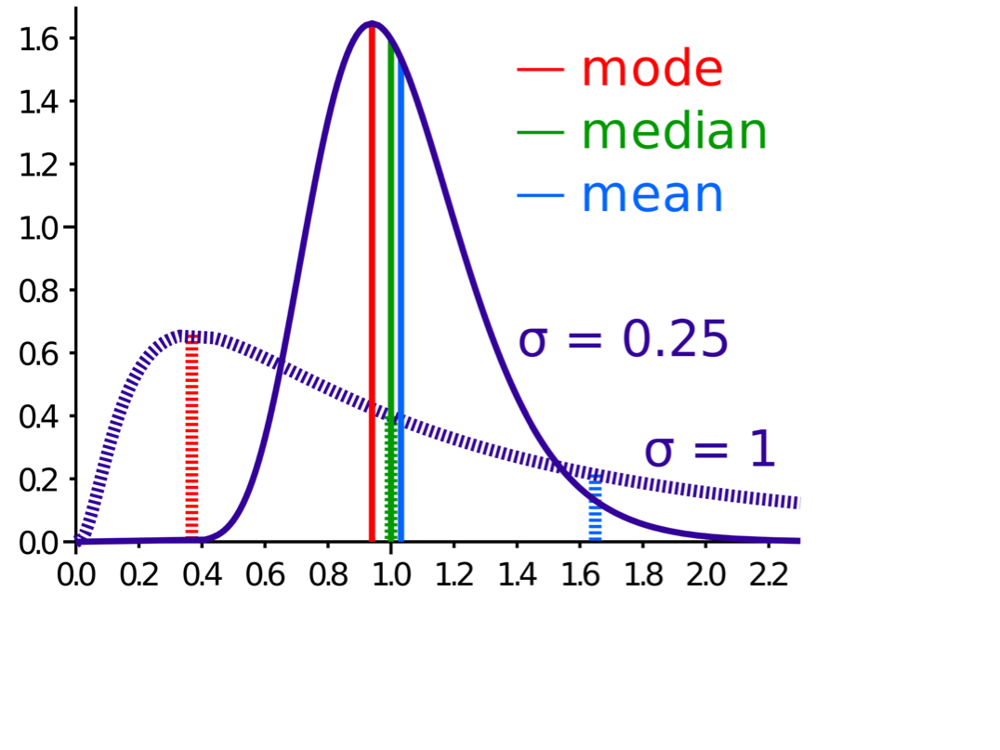

Cmglee, <a href="https://commons.wikimedia.org/w/index.php?curid=15147460">Wikimedia Commons</a>, CC BY-SA 3.0.

---

## Czy przerwa przeszkadza jednakowo?

Ci sami widzowie oceniają dwie sceny: każdą bez przerwy i z przerwą.

| Przykładowy MOS | Bez przerwy | Z przerwą |
| :--- | ---: | ---: |
| Scena spokojna | 4,4 | 3,8 |
| Scena dynamiczna | 4,4 | 3,0 |

W przykładzie spadek średniej jest większy dla sceny dynamicznej. Czy da się to uogólnić? Potrzebujemy więcej treści oraz różnic ocen poszczególnych widzów.

---

## Porównywanie wyników

Uczestnicy różnie korzystają ze skali. Zanim porównasz średnie, obejrzyj rozkład ocen i sprawdź, czy oceny są sparowane.

**Test t-Studenta** może służyć do porównania średnich, gdy odpowiada projektowi badania i spełnione są jego założenia. Sama istotność statystyczna nie mówi, czy różnica jest praktycznie ważna.

---

## Rozkład ocen a test t

Uczestnicy nie zawsze wykorzystują całą skalę. Przy tych samych widzach porównujemy **różnice sparowane**, np. ocenę wersji źródłowej i przetworzonej.

Normalny kształt rozkładu wszystkich ocen razem nie sprawdza założeń tego testu.

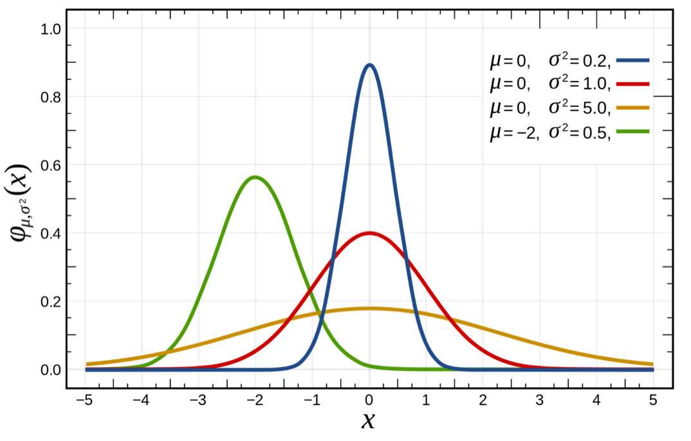

---

## Czy różnica jest odróżnialna od zera?

Na przykład: czy widzowie oceniają próbkę na granicy akceptacji inaczej niż źródło? W teście sparowanym sprawdzamy średnią różnicę ocen dla tych samych osób.

---

## Zależność nie musi być liniowa

Niewielka poprawa parametru może być niezauważalna przy bardzo dobrej jakości, a wyraźnie odczuwalna w pobliżu progu akceptacji.

**Krzywa logistyczna** to jeden ze sposobów dopasowania takiej zależności. Parametry wyznacza się z ocen, a model sprawdza na innych danych.

---

## Krzywa logistyczna: co zmienia jej kształt?

<code>f(x) = a + (L - a) / (1 + exp(-k(x - x₀)))</code>

- `a`, `L`: dolna i górna asymptota
- `x₀`: położenie środka przejścia
- `k > 0`: stromość wzrostu

<code>exp</code> oznacza funkcję wykładniczą.

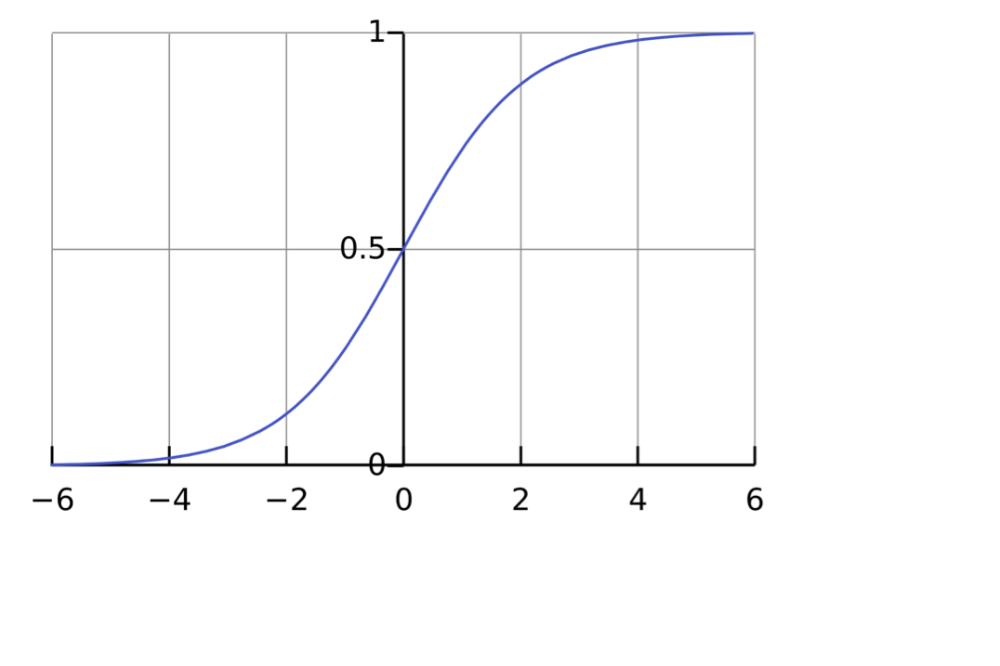

Qef, <a href="https://commons.wikimedia.org/w/index.php?curid=4310325">Wikimedia Commons</a>, domena publiczna.

---

## Pułapki eksperymentu

- Jedna irytująca próbka może zmienić sposób oceniania kolejnych.
- Zmęczenie i kolejność prezentacji mogą wpłynąć na wynik.
- Obserwacji odstających nie usuwa się tylko dlatego, że są niewygodne. Reguły wykluczeń ustala się z góry.

Uczestnik może w praktyce ocenić całe doświadczenie udziału, a nie bieżącą próbkę. Dlatego projekt, instrukcja i ograniczenia eksperymentu wpływają na interpretację wyniku.

---

## Co może zmienić odpowiedź widza?

  
<strong>Przygotowanie</strong> Spójna instrukcja i trening

  
<strong>Zakłócenia</strong> Ocena całej sesji zamiast próbki

  
<strong>Uczestnik</strong> Różne sposoby korzystania ze skali

  
<strong>Laboratorium</strong> Wynik zależy od warunków badania

---

## Jak rozpoznać obserwację odstającą?

Punkt oddalony od grupy to sygnał do sprawdzenia, nie powód do automatycznego usunięcia.

Korelacja Pearsona bywa miarą zgodności ocen. Pokazany w archiwum próg 0,75 nie jest ogólną regułą wykluczania uczestników.

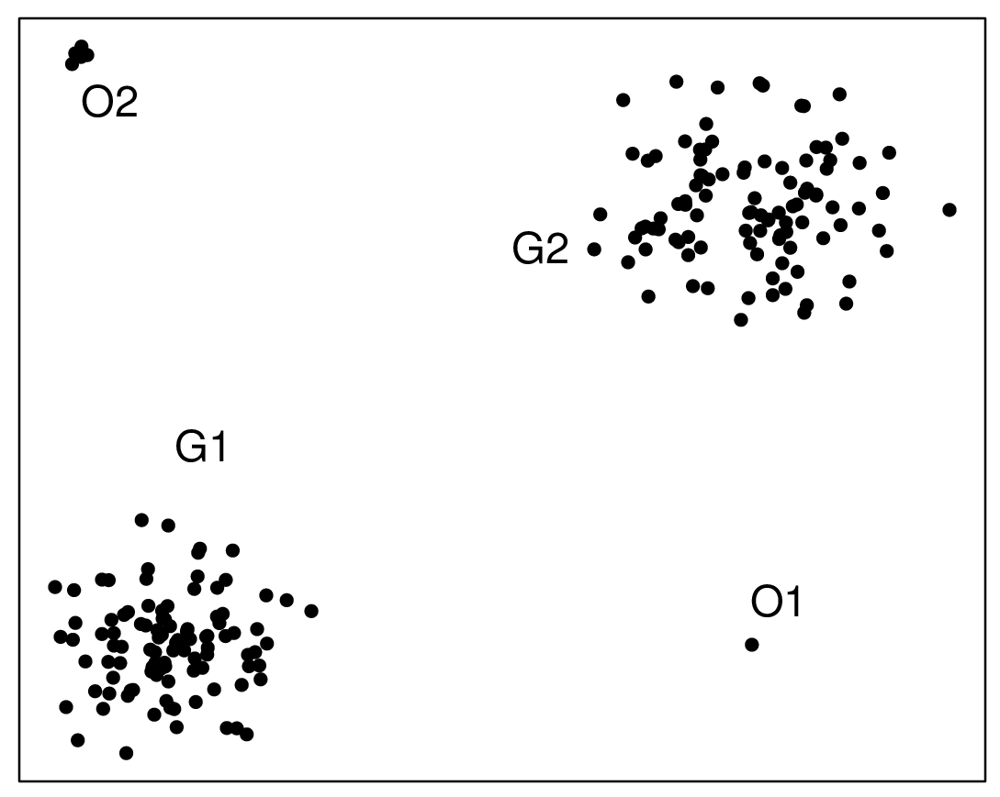

Osrecki, <a href="https://commons.wikimedia.org/w/index.php?curid=48650484">Wikimedia Commons</a>, CC BY-SA 4.0.

---

## Po co automatyczny pomiar?

Test z udziałem ludzi pomaga zrozumieć odbiór, ale nie da się go uruchamiać dla każdej sesji.

**KPI (Key Performance Indicators)** to kluczowe wskaźniki monitorowania. Przykłady: czas startu, liczba i czas przerw oraz wskaźniki zniekształceń obrazu.

---

## Zalety pomiaru algorytmicznego

Pomiar można powtarzać według jednej procedury. Wynik jest liczbowy, łatwy do przetwarzania i da się go włączyć do systemu monitorowania.

---

## Gdzie powstaje zniekształcenie?

| Etap | Przykład problemu |
| :--- | :--- |
| Rejestracja | Nieostrość lub szum |
| Przetwarzanie | Artefakty kompresji |
| Dostarczanie i odtwarzanie | Braki danych lub przerwy |
| Wyświetlanie | Skalowanie i ograniczenia ekranu |

Automatyczny wskaźnik może wykryć objaw. Nie zawsze pozwala wskazać etap, na którym powstał problem.

---

## Obraz kontrolny

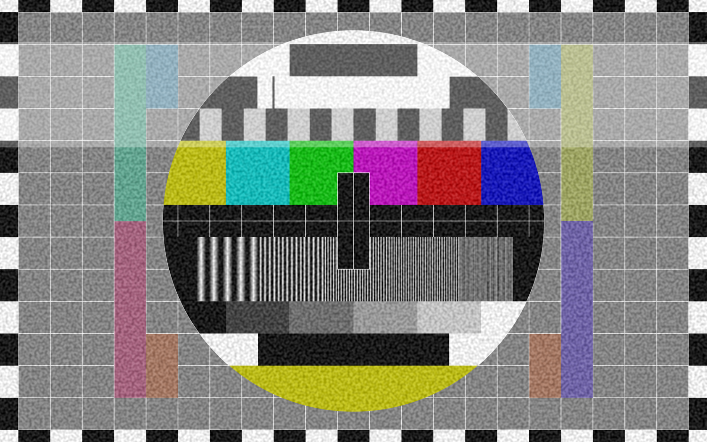

Stały wzorzec pozwala porównać to, co dzieje się z kolorem, detalem i geometrią na różnych etapach toru.

---

## Ile wiemy o oryginale?

| Metoda | Dane potrzebne do oceny |
| :--- | :--- |
| Pełna referencja | Oryginał i oceniane wideo |
| Ograniczona referencja | Wybrane cechy oryginału i oceniany materiał |
| Bez referencji | Tylko oceniany materiał, bez oryginału |

Można też analizować **strumień bitowy** zamiast obrazu po dekodowaniu, jeśli dostępne są odpowiednie dane zakodowanego wideo.

---

## Pomiar bez referencji

Sondę można umieścić tam, gdzie dostępny jest obraz, nawet bez dostępu do źródła oraz parametrów kodowania i transmisji.

Trudność: model ma opisać to, co zauważa ludzki układ wzrokowy, bez bezpośredniego porównania z oryginałem.

---

## Pomiar z pełną referencją

Przy dostępie do źródła można porównać je z przetworzonym obrazem. To przydatne np. przy sprawdzaniu skutków kompresji przez dostawcę treści.

Koszt zależy od metody. Porównanie może wymagać dopasowania klatek i znacznych obliczeń.

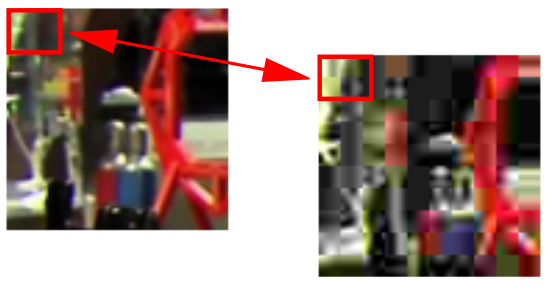

---

## Przykład: pomiar rozmycia

**VQI (Video Quality Indicator)** może oszacować widoczne rozmycie na podstawie cech obrazu, np. tego, jak szerokie jest przejście na krawędzi.

Bez oryginału nie wiadomo jednak, czy miękka krawędź wynika z usterki, czy była zamierzona. Pojedynczy wskaźnik nie zastępuje oceny całej usługi.

---

## Jak wskaźnik widzi rozmycie?

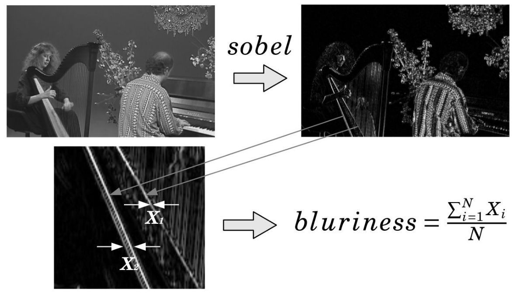

Przykład z materiałów AGH: wykrycie krawędzi filtrem Sobela, pomiar ich szerokości i uśrednienie wyników.

---

## Jak powstaje model jakości?

1. Zbierz oceny widzów oraz dane o sygnale i odtwarzaniu.
2. Wybierz cechy i dopasuj model do ocen z eksperymentu.
3. Sprawdź przewidywania na innych treściach i zakłóceniach.

Model przewiduje **to, co oceniano w testach**. Jeśli uczestnicy oceniali obraz, wynik nie obejmuje np. użyteczności odtwarzacza ani reakcji na reklamy.

---

## Co wchodzi do modelu i co z niego wychodzi?

  
<strong>Dane wejściowe</strong> Parametry sieci i cechy pikseli

  
<strong>Model jakości</strong> Kalibracja na ocenach widzów

  
<strong>Wynik</strong> Przewidywana ocena jakości

Nie każdy model wykorzystuje wszystkie wejścia. Dobieramy je do tego, co możemy zmierzyć i przewidywać.

---

## Od badań AGH do zastosowań

Archiwalne materiały AGH opisują zestaw **15 wskaźników jakości wideo zaimplementowanych w C**, w tym wskaźnik rozmycia, oraz prace nad pomiarem bez materiału odniesienia.

Zastosowania: diagnostyka usług wideo, porównywanie ustawień kompresji, ocena materiału do konkretnych zadań oraz transfer narzędzi do praktyki.

---

## Jak rozwijano metody na AGH?

Zespół przygotowywał eksperymenty zgodnie ze standardami, proponował własne metody badań i analizy wyników oraz przeprowadził liczne testy. Z błędów popełnionych przy testach wyciągał wnioski na przyszłość.

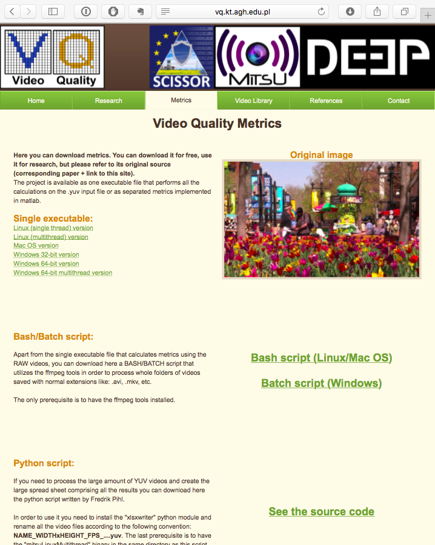

Zrzut strony ma charakter historyczny. Nie potwierdza dzisiejszej dostępności plików.

---

## Projekty: instytucje widoczne w archiwum

  
  
  
  
  
  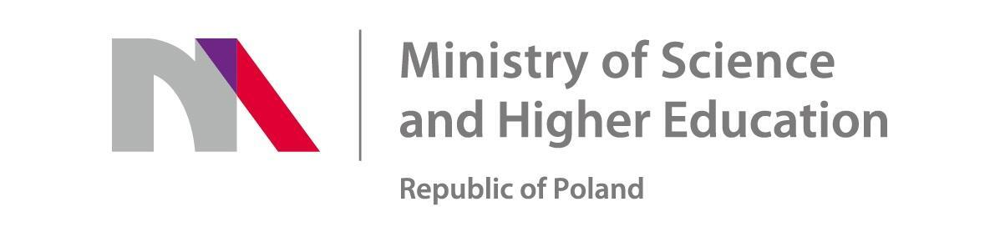
  

Zestaw historyczny z wykładu PT. Nie jest listą obecnych partnerstw.

---

## Współpraca międzynarodowa: ocena wideo

**VQEG (Video Quality Experts Group).** Materiały dokumentują udział od 2008 r., pracę w zarządzie, współprowadzenie projektów z partnerami z Gandawy, Nantes, Rohde & Schwarz i amerykańskiej NTIA oraz współpracę przy przygotowaniu testów.

**Video Quality in Public Safety.** Materiały odnotowują udział od 2010 r. w inicjatywie wspieranej przez amerykański Departament Bezpieczeństwa Krajowego, m.in. w opracowaniu poradników do zastosowań wideo.

---

## Organizacje zajmujące się oceną wideo

---

## Współpraca: standaryzacja i delegacja

**Ministerstwo Cyfryzacji**

Materiały odnotowują nominację do reprezentowania Polski od 2014 r.

**Międzynarodowy Związek Telekomunikacyjny**

Materiały dokumentują udział zespołu w pracach ITU-T od 2014 r.

---

## Współpraca i standaryzacja

- **VQEG (Video Quality Experts Group):** wspólne badania i porównania metod oceny wideo.
- **ITU-T:** sektor normalizacji Międzynarodowego Związku Telekomunikacyjnego.
- **P.912:** subiektywna ocena wideo w zadaniach rozpoznawania.
- **J.343:** hybrydowe modele oceny percepcyjnej łączące informacje ze strumienia bitowego i przetworzonego wideo.

---

## Przykłady wkładu w zalecenia

**P.912:** rozszerzenie opisu materiałów źródłowych, metod testu, projektu eksperymentu oraz warunków odniesienia, oglądania i odsłuchu.

**J.343:** wyniki techniczne przedstawione w pracach niezależnej grupy laboratoriów, z angielskiego *Independent Lab Group* (ILG).

---

## Transfer technologii i upowszechnianie

W materiałach odnotowano podpisanie umowy licencyjnej w 2013 r. oraz prace nad kolejną. Nie ma tam potwierdzenia, że drugą umowę zawarto.

Archiwalny bilans zespołu: blisko 100 publikacji i 100 wystąpień, ponad 10 konferencji lub sesji specjalnych oraz ponad 10 numerów specjalnych czasopism związanych z QoE. Liczby dotyczą okresu opisywanego w źródle.

---

## Od wyniku do decyzji

Widzowie zgłaszają, że film się zacina, choć średnia przepływność wygląda dobrze.

**Co sprawdzić?** Czas i miejsca przerw, poziom bufora oraz zmiany wariantu. Następnie porównać dwa ustawienia odtwarzacza na tych samych treściach i z udziałem widzów.

---

## Trzy pytania o jakość

1. **Co zmierzyliśmy?** Parametry sieci, sygnału czy sesji odtwarzania?
2. **Co odczuł widz?** Czy usługa pozwoliła wykonać zadanie?
3. **Na czym opiera się wniosek?** Na ocenach ludzi czy na modelu skalibrowanym względem tych ocen?

---

## Nagranie źródłowego wykładu

Wersja angielska z AMIPaC (19:18). Osobny materiał do odtworzenia, bez powtarzania części wykładowej.

<video controls playsinline preload="metadata" style="max-height:370px"><source src="media/local-replacements/qoe-wyklad.mp4" type="video/mp4" onerror="this.parentElement.hidden=true;this.parentElement.nextElementSibling.hidden=false"></video>

Brak lokalnej kopii nagrania. Źródłowy plik MP4 jest w materiałach AMIPaC do wykładu Multimedia Quality of Experience.

<!-- study-only:start -->

### Materiały źródłowe

- Mikołaj Leszczuk, Zdzisław Papir, Lucjan Janowski, Jakub Nawała, *Multimedia Quality of Experience (QoE)*, archiwalny wykład 14 PT i materiały AMIPaC.
- Mikołaj Leszczuk, materiały EET: odbiór jakości usług i ekosystem mediów.
- *Connection-Oriented Streaming of Multimedia Content*, wspólny wykład PT i AMIPaC. Przykład dwóch odtwarzaczy i przykładowe oceny ACR są dydaktyczne, nie są wynikami pomiaru.
- [ITU-T P.910](https://www.itu.int/rec/T-REC-P.910), [ITU-T P.912](https://www.itu.int/rec/T-REC-P.912) i [ITU-T J.343](https://www.itu.int/rec/T-REC-J.343).

### Kontekst historyczny badań AGH

Archiwalna prezentacja opisuje zbiór 15 wskaźników VQI zaimplementowanych w C, współpracę w VQEG i programie Video Quality in Public Safety, udział w pracach ITU-T oraz umowę licencyjną z 2013 r. To udokumentowane przykłady zastosowań z okresu powstania prezentacji, nie aktualny wykaz projektów ani deklaracja dostępności oprogramowania.

Prognozy Cisco do 2022 r. z dawnego wykładu dotyczą m.in. ruchu wideo oraz całkowitego ruchu na użytkownika stacjonarnego internetu konsumenckiego. Nie są pomiarem rzeczywistego ruchu z 2022 r. ani prognozą samego wysyłania.

<!-- study-only:end -->
